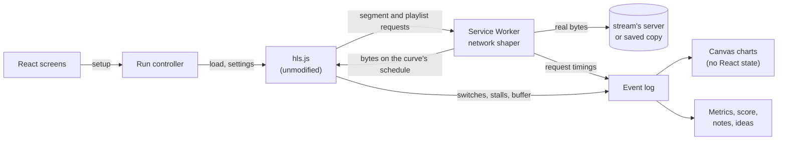

# Rebuffer

**See how a video player survives a bad network, in your browser.** Live at
[rebuffer.azamatos.com](https://rebuffer.azamatos.com).

Pick a stream, pick a network ("train through a tunnel", "busy café Wi-Fi", or a bandwidth curve you draw), press
**Run**, and watch a real hls.js player fight it: the bandwidth it gets, what it thinks it gets, the quality it picks,
the buffer draining, every stall. Then read a report with the numbers viewers feel, and what to try next.

## What you can do

- **Run** any HLS stream through a simulated network, with three live charts on one time axis (bandwidth and
  quality, buffer, segment downloads) and an event log.
- **Draw a network**: a bandwidth curve with the stream's qualities drawn over it, so you see where each one stops
  fitting. Seven presets, four recorded 4G journeys, or your own; works with the keyboard alone. Import and export
  JSON or CSV.
- **Tune the player**: hls.js defaults, a low-memory TV preset, quality first, fast start, or one setting changed.
- **Read the report**: a score from a published QoE model with its breakdown, numbered notes on what happened when,
  ideas to try next (each the same setup with one change), zoomable charts, JSON export, a link to the setup.
- **Compare two runs**: their numbers side by side with the difference in words, what their setups changed, and the
  charts overlaid.
- **Inspect a playlist**: the ladder with declared, average and measured bitrates, codecs in plain words, segments,
  and findings with the line, the file and the spec they break.

Everything runs in your browser: no backend, no accounts; runs and networks stay in the browser that made them.

## How it works

- **The player is the real one.** hls.js keeps its own loader, bandwidth estimator and abandon rules; the lab
  never touches its logic.
- **The network is simulated where the player can't tell.** A Service Worker answers every request the player
  makes, fetches the real bytes and releases them on the schedule the network curve allows: one round trip before
  the first byte, parallel downloads sharing the bandwidth fairly. The link scheduler is a pure module
  (`src/core/netsim`) tested with a fake clock.
- **Honest numbers.** The simulation can slow a download down, never speed it up. Every response records when its
  bytes really arrived; the result says how many downloads started or arrived late because the visitor's own
  network was slower, and why. Repeat runs take their bytes from a copy saved in the browser, so they don't depend
  on the visitor's connection.
- **A framework-free core.** `src/core` (playlist parser, network simulator, metrics, player adapter, report text)
  imports no React. Live chart data goes from the event log to the canvases on each animation frame, never through
  React state.

## Measured

| What                                                                           | Result                                                                                                         |
| ------------------------------------------------------------------------------ | -------------------------------------------------------------------------------------------------------------- |
| Shaper accuracy (1 MiB at 4 Mbps steps, 100 ms RTT; Chromium, Firefox, WebKit) | 3–24 ms behind the curve, never ahead                                                                          |
| Live charts, per frame at 4× CPU throttling                                    | 0.1 ms median, 1.8 ms at most                                                                                  |
| Repeatability: each of the 7 presets run 5 times (below)                       | Scores within 1 point of each other; the same stalls and switches; no late downloads                           |
| Home's JavaScript (brotli, budget 100 KB)                                      | 95.1 KB                                                                                                        |
| Lighthouse on Home (local)                                                     | performance 98–99, accessibility, best practices and SEO 100                                                   |
| Tests                                                                          | 484 unit tests; 138 Playwright checks in Chromium, Firefox and WebKit, with axe on every screen in both themes |

### Repeatability

Chromium 156.0.8078.4, hls.js 1.7.3; stream: synthetic, 2:00, five qualities from 240p (0.47 Mbps) to 1080p (6 Mbps), 4 s segments; measured 2026-10-20.
Scores across runs of one network differ by at most 1 point (median spread 1 point).

| Network                | Runs | Score | Spread | First frame     | Stalls | Stall time  | Average bitrate     | Switches | Late downloads |
| ---------------------- | ---- | ----- | ------ | --------------- | ------ | ----------- | ------------------- | -------- | -------------- |
| Home fibre             | 5    | 90–91 | 1      | 0.37 s–0.60 s   | 0      | 0.0 s       | 5.59 Mbps           | 1        | 0              |
| Busy café Wi-Fi        | 5    | 39    | 0      | 2.99 s–3.03 s   | 0      | 0.0 s       | 3.04 Mbps           | 0        | 0              |
| 4G commute             | 5    | 68–69 | 1      | 1.70 s–1.73 s   | 0      | 0.0 s       | 4.50 Mbps–4.56 Mbps | 3        | 0              |
| Train through a tunnel | 5    | 8–9   | 1      | 2.23 s–2.24 s   | 1      | 2.5 s–2.7 s | 1.97 Mbps–1.98 Mbps | 4        | 0              |
| Rural 3G               | 5    | 0     | 0      | 11.55 s–11.58 s | 0      | 0.0 s       | 0.61 Mbps           | 1        | 0              |
| Lift                   | 5    | 41–42 | 1      | 1.59 s–1.71 s   | 0      | 0.0 s       | 3.04 Mbps           | 0        | 0              |
| Evening congestion     | 5    | 89    | 0      | 1.20 s–1.22 s   | 0      | 0.0 s       | 5.53 Mbps–5.54 Mbps | 2        | 0              |

`pnpm repeat` measures it (`tests/repeat/README.md`): one run at a time, the stream from a local server, so the real
network never holds a run back. The synthetic stream's scores aren't our film's: its ladder and segments differ. The
first run in a fresh browser starts slower (Home fibre's 0.60 s) while the page's Service Worker starts.

## Run it locally

Needs Node 22.12+ and pnpm 10; the end-to-end tests also need ffmpeg (they build a small synthetic stream).

| Command                                              | What it does                                                                                         |
| ---------------------------------------------------- | ---------------------------------------------------------------------------------------------------- |
| `pnpm dev`                                           | Dev server on http://localhost:4002                                                                  |
| `pnpm typecheck` · `pnpm lint` · `pnpm format:check` | Types, ESLint (strict, type-checked), Prettier                                                       |
| `pnpm test`                                          | Vitest: unit tests for `src/core`                                                                    |
| `pnpm e2e`                                           | Playwright with axe in Chromium, Firefox and WebKit; builds and serves on port 4012                  |
| `pnpm repeat`                                        | The repeatability job: every preset five times in Chromium (about an hour; `tests/repeat/README.md`) |
| `pnpm build` · `pnpm size`                           | Production build (Home rendered at build time); bundle budgets                                       |
| `pnpm media:encode`                                  | Our sample streams from _Tears of Steel_ (`scripts/media/README.md`)                                 |

CI (`.github/workflows/ci.yml`) runs all of these except the repeatability job, plus Lighthouse CI; the
repeatability job runs weekly and by hand (`.github/workflows/repeat.yml`).

## Content and credits

- Sample film: _Tears of Steel_, (CC) Blender Foundation | mango.blender.org, used under CC BY 3.0 and
  re-encoded for streaming, never cut.
- Recorded networks: excerpts of the Irish 4G dataset (Raca et al., ACM MMSys 2018, CC BY 4.0), converted.
- Public test streams from Unified Streaming, Apple and Mux are links to their servers; we don't host them.
- Score: the linear QoE model from Yin et al., SIGCOMM 2015.

## Docs

- `AGENTS.md`: instructions for coding agents.
- `docs/memory-bank/`: the brief, product spec, technical plan, roadmap and current state.

MIT licence. Built by [Azamat Jorayev](https://azamatos.com), who has built HLS players for a video platform with
100k+ users and Smart TV apps.
